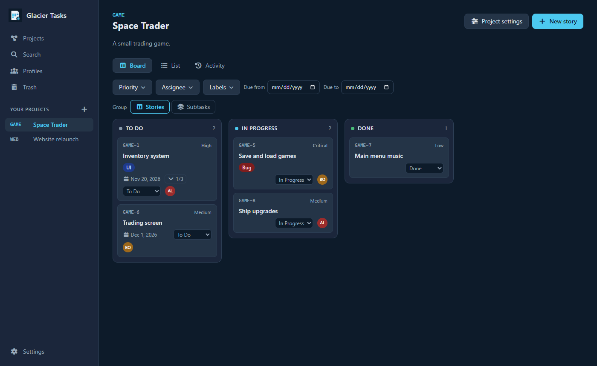
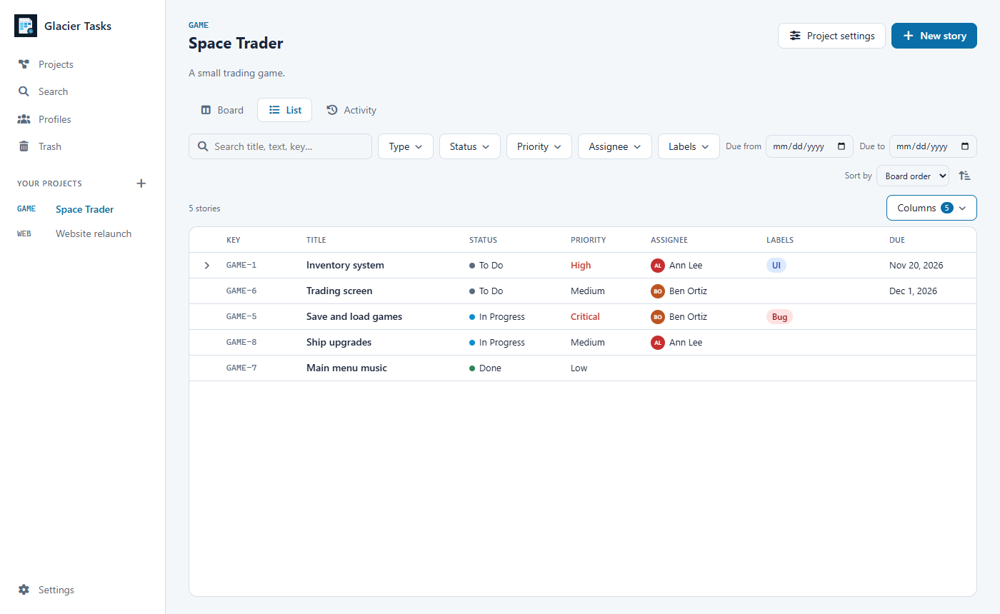
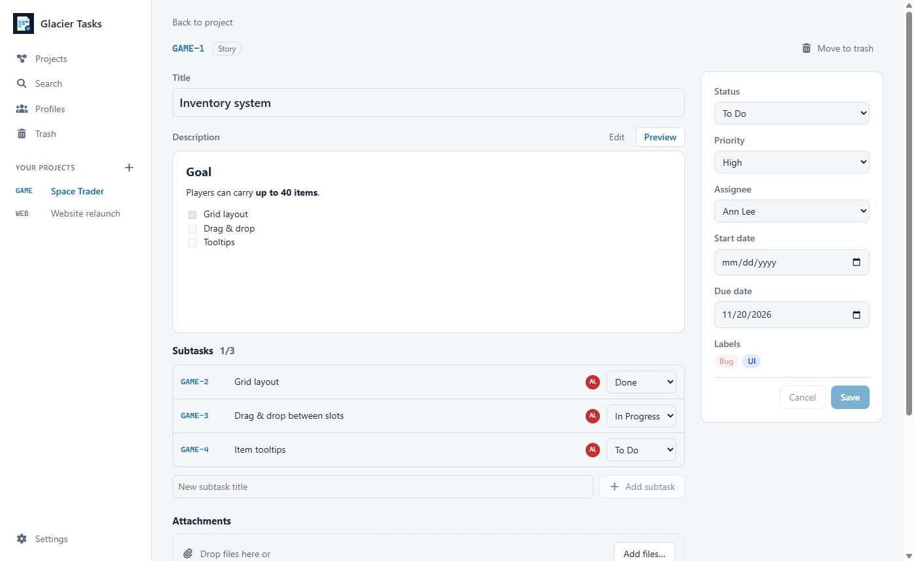

# Glacier Tasks

An offline, Jira-inspired task planner for Windows and Linux. Projects, stories with one level
of subtasks, a Kanban board, a list view with full-text search, attachments, a complete change
history, and full backups. All data stays on your computer: no account, no server, and no
network requests.



| List with search and filters | Story with Markdown and subtasks |
| --- | --- |
|  |  |

## Features

- **Projects** with their own keys (`GAME-12`), workflows (statuses with To do / In progress /
  Done categories) and labels.
- **Stories and subtasks** with priority, assignee, start and due date, labels and a Markdown
  description (preview, read-only checklists, inline images from the task's own attachments).
- **Board:**
  - drag and drop between and within status columns
  - optional grouping by subtasks, where each story gets a swimlane and its subtasks move on
    their own
  - filters on story fields
- **List** with a virtual-scrolling tree of stories and subtasks, column picker, sorting,
  filters and full-text search. There is also a **search page** for one or all projects
  (Ctrl+F).
- **Attachments** copied into managed storage; previews for PNG/JPEG/GIF/WebP.
- **History** for tasks, projects, statuses, labels and profiles, including every description
  version with a comparison view.
- **Trash** with cascade semantics and permanent deletion; **complete backups**
  (`.glaciertasks`), restore, opt-in automatic backups, and a JSON export (not restorable).
- **Light, dark and system themes; English and German UI.**

## Download and install

Installers for each version are on the
[releases page](https://github.com/Cracksoldier/glacier-tasks/releases):

- Windows x64: NSIS installer
- Linux x64: AppImage and deb package

The builds are not code-signed, so check the downloads against `SHA256SUMS.txt`. The user guide
explains installation, data folders, backups and troubleshooting:
[English](docs/user-guide.en.md) · [Deutsch](docs/user-guide.de.md).

## Building from source

Requirements: Node.js 24 and npm. Windows 11 or Linux x64.

```bash
npm ci
npm run build            # domain → data → ui → desktop
npm start                # dev mode: tsc watch, ng serve on :4200, Electron with GLACIER_DEV=1
npm test                 # unit tests in all workspaces + translation check
npm run e2e              # Playwright against the built, unpackaged app (run build first)
npm run package:dir --workspace @glacier-tasks/desktop   # unpacked package in apps/desktop/release
npm run smoke            # packaged self-test (after package:dir)
```

Other scripts:

| Script | What it does |
| --- | --- |
| `npm run format` / `format:check` | Biome formatting (Markdown and YAML by hand) |
| `npm run verify:offline` | fails if the renderer build references remote resources |
| `npm run check:i18n` | fails if a translation key is unused |
| `node scripts/generate-icons.mjs` | re-renders icons from `apps/desktop/build/icon.svg` |

`GLACIER_USER_DATA=<dir>` points any run at a separate data folder; never test against your
real data.

## Architecture

| Path | Contents |
| --- | --- |
| `packages/domain` | pure TypeScript shared by all processes: models, Zod schemas for every IPC input, the IPC contract, sort keys, backup format |
| `packages/data` | SQLite (better-sqlite3) migrations and services; main process only |
| `apps/desktop` | Electron main process and preload: IPC dispatcher, file stores, backups, security |
| `apps/ui` | Angular renderer (standalone, zoneless, signals) |
| `tests/e2e` | Playwright end-to-end tests |

Decisions and design:
- [`docs/DECISIONS.md`](docs/DECISIONS.md): product decisions D01–D55
- [`docs/adr/`](docs/adr): architecture decision records
- [`docs/architecture.md`](docs/architecture.md): invariants I01–I31
- [`docs/threat-model.md`](docs/threat-model.md) and
  [`docs/security-review.md`](docs/security-review.md)
- [`docs/acceptance-matrix.md`](docs/acceptance-matrix.md): which tests prove each v1
  requirement

Requirements and milestones are in [`docs/GLACIER_TASKS_SPEC.md`](docs/GLACIER_TASKS_SPEC.md)
and [`docs/GLACIER_TASKS_MILESTONES.md`](docs/GLACIER_TASKS_MILESTONES.md).

## Releases

Pushing a `vX.Y.Z` tag, or running the **Release builds** workflow manually, does the release.

1. **Quality gate:** the workflow stamps the version and runs format, build, tests, the offline
   check and the end-to-end tests.
2. **Packages:** it builds the NSIS installer, AppImage and deb on Windows and Linux runners.
3. **Smoke test:** each package passes its own self-test.
4. **Publishing:** it creates a GitHub Release with `SHA256SUMS.txt`.
   - Stable versions need hand-written notes in `docs/release-notes/vX.Y.Z.md`.
   - Versions with a pre-release suffix are published as pre-releases.

## License

[MIT](LICENSE) © 2026 Cracksoldier
